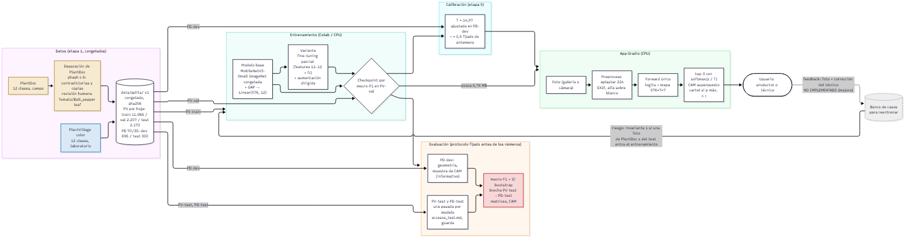

# Arquitectura del sistema

Dos circuitos sobre el mismo modelo: el de **evaluación** (dónde está el aporte: el mismo modelo, mismos pesos y mismo
preproceso, medido en dos dominios) y el de **producción** (la app). PlantDoc nunca entra al entrenamiento ni a la selección del
checkpoint (invariante 1). El lazo de feedback está dibujado punteado: **no está implementado** (mejora, ver el informe §3).



Fuente del diagrama: [`arquitectura.mmd`](arquitectura.mmd) (Mermaid; GitHub también lo muestra). Se exporta con:

```
npx -y @mermaid-js/mermaid-cli -i docs/arquitectura.mmd -o docs/figuras_finales/arquitectura.png -s 2
```

**Cómo leerlo.** Azul: laboratorio. Ocre: campo. Rojo: resultado principal (la brecha). Gris punteado: no implementado.
Las cifras del diagrama salen de `data/splits/README_VERSION.md` (congelamiento), de `configs/05_calibracion.yaml` (T, τ) y de
`results/06_app/06_app_latencia_20261110_150137/latencia.json` (tamaño de los pesos); ver `docs/trazabilidad.md`.
