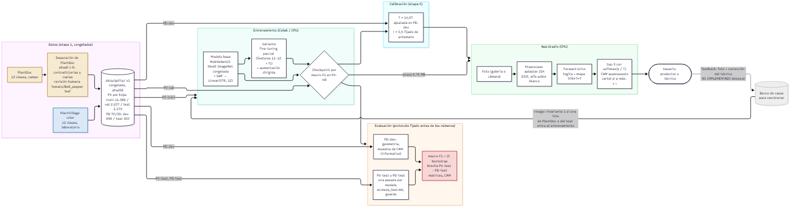
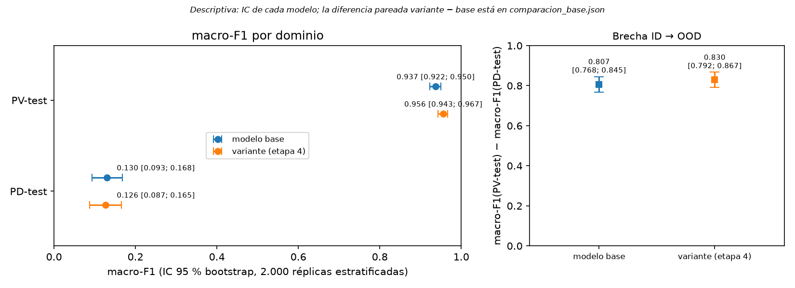
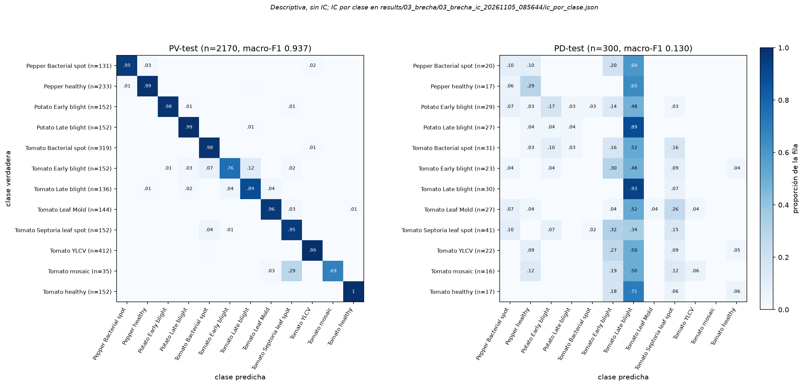
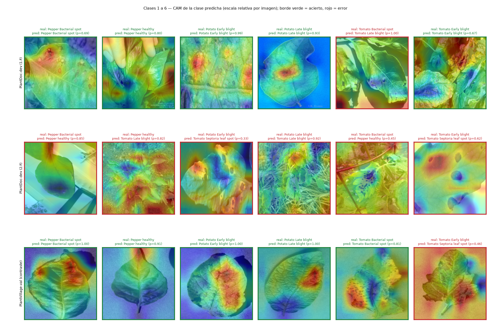
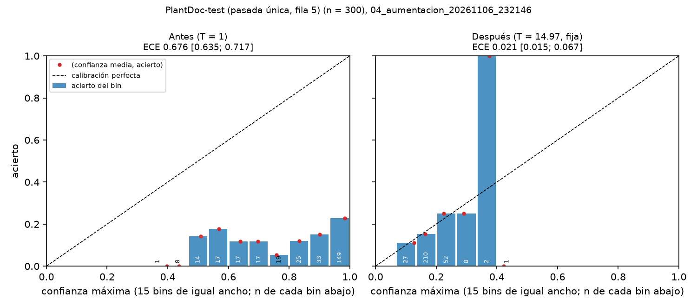

# Clasificador de enfermedades foliares y medición de su degradación de laboratorio a campo

**Entregable 2: fundamentación técnica.** Licenciatura en Ingeniería de Datos e Inteligencia Artificial, UTEC.

César Trajano Carballo Asis · Juan Lucas Pimentel Barreto · Victor Samuel Uría Padilla. Docente: Juan Pedro de León Sum.
Fecha: [PENDIENTE: fecha de entrega].

<!-- Cada número de este documento tiene su fila en docs/trazabilidad.md; el ID va en un comentario junto al número.
     Lo que no está en results/ ni en las configs va marcado [PENDIENTE]. -->

## Resumen

Entrenamos un clasificador de 12 enfermedades y estados sanos de tomate, papa y pimiento <!-- P1 --> con fotos de laboratorio
(PlantVillage) y lo evaluamos con fotos de campo (PlantDoc) que nunca participaron del entrenamiento. El macro-F1 cae de
0,937 [0,922; 0,950] a 0,130 [0,093; 0,168]: una brecha de 0,807 [0,768; 0,845] <!-- E6 E8 E9 -->. Fuera de distribución el
modelo no se equivoca al azar: colapsa hacia una sola clase, *Tomato late blight*, y lo hace con alta confianza. Una variante con
fine-tuning parcial y aumentación dirigida mejora el laboratorio pero no el campo: la diferencia pareada en PlantDoc-test es
-0,004 [-0,030; 0,023] <!-- E29 -->. La calibración por temperatura corrige la sobreconfianza (el ECE en PlantDoc-test baja de
0,676 a 0,021 <!-- C13 C14 -->), pero con el umbral fijado de antemano el sistema calibrado no responde ninguna foto. La app en
Gradio muestra igual su mejor sugerencia, con un cartel de confianza baja, y responde en unos 22 ms en CPU <!-- A8 -->. El
resultado central no es un modelo que funcione en el campo, sino una medición honesta de cuánto no funciona y de por qué.

## 1. Problema y pregunta

La detección temprana de enfermedades foliares decide si una intervención llega a tiempo, y una aplicación que clasifique la
enfermedad a partir de una foto parece la respuesta obvia. La literatura reporta exactitudes cercanas al 99 %, pero esas cifras se
obtienen entrenando y evaluando sobre el mismo tipo de imagen: hoja arrancada, fondo uniforme, luz controlada. Mohanty, Hughes y
Salathé (2016) obtuvieron 99,35 % en un test retenido de PlantVillage y 31,4 % al evaluar con imágenes tomadas en otras
condiciones <!-- R1 -->. Un modelo que aprende una correlación espuria del conjunto de entrenamiento y colapsa al cambiar el
dominio es uno de los modos de falla más comunes y más caros de los sistemas de aprendizaje automático en producción; estudiarlo
con datos públicos es una forma barata de aprender algo que en un despliegue real se paga caro.

**Pregunta del proyecto.** ¿Cuánto rendimiento pierde un clasificador de enfermedades foliares al pasar de imágenes de
laboratorio a imágenes de campo, qué mira el modelo cuando se equivoca, y cuánto de esa brecha se recupera con intervenciones
acotadas? El entregable no es solo un modelo: es un modelo más una medición de su condición de despliegue, y un sistema que,
cuando no está en condiciones de opinar, lo dice.

**Usuario.** El usuario directo es un productor o técnico agrónomo que sube la foto de una hoja y recibe una sugerencia con su
nivel de confianza. El sistema se presenta como asistente de orientación, nunca como diagnóstico, y asume siempre una persona en
el circuito. El beneficiario del hallazgo es un equipo técnico que evalúa desplegar visión por computadora: el número de la brecha
le dice cuánto descontar a las métricas publicadas antes de invertir.

## 2. Datos

### 2.1 Fuentes

| Conjunto | Rol | Contenido (copia fijada por commit) |
|---|---|---|
| PlantVillage (Hughes y Salathé, 2015) | Entrenamiento, validación y test en distribución | 54.305 imágenes color en 38 clases <!-- R2 -->; hoja individual, fondo uniforme, luz controlada |
| PlantDoc (Singh et al., 2020) | Desarrollo (dev) y test fuera de distribución | 2.578 imágenes en 28 carpetas de clase <!-- R3 -->; fotos de campo e internet, fondos complejos |

Los dos repositorios se descargaron en un commit fijado y verificado. La copia fijada de PlantDoc no coincide con lo que declara el
paper (2.598 imágenes y 27 clases <!-- R4 -->): las diferencias quedaron documentadas en `docs/exploracion_datasets.md` y no
cambian el procedimiento.

### 2.2 Mapeo a 12 clases

Las taxonomías no coinciden una a una. El equipo se quedó con tomate, papa y pimiento (maíz quedó fuera porque su intersección real
con PlantDoc era pobre) y con las clases que tienen par en ambos conjuntos. De las 13 con par se excluyó *Tomato two spotted
spider mites*, que en PlantDoc tiene 2 imágenes en train y ninguna en test <!-- D19 -->. *Target Spot* y *Potato healthy* no tienen par y no
entran al entrenamiento. Quedan 12 clases <!-- P1 -->:

| PlantVillage | PlantDoc |
|---|---|
| Pepper bell Bacterial spot | Bell_pepper leaf spot |
| Pepper bell healthy | Bell_pepper leaf |
| Potato Early blight | Potato leaf early blight |
| Potato Late blight | Potato leaf late blight |
| Tomato Bacterial spot | Tomato leaf bacterial spot |
| Tomato Early blight | Tomato Early blight leaf |
| Tomato Late blight | Tomato leaf late blight |
| Tomato Leaf Mold | Tomato mold leaf |
| Tomato Septoria leaf spot | Tomato Septoria leaf spot |
| Tomato Yellow Leaf Curl Virus | Tomato leaf yellow virus |
| Tomato mosaic virus | Tomato leaf mosaic virus |
| Tomato healthy | Tomato leaf |

Dos clases de PlantDoc son ambiguas: *Tomato leaf* y *Bell_pepper leaf* no dicen "sana", y el paper las cuenta entre las clases
sanas. Se tratan como sanas, con revisión humana de sus etiquetas (§2.3).

### 2.3 Depuración de PlantDoc

PlantDoc se recolectó de internet, y su copia fijada conserva duplicados que el paper declara haber quitado. Con hash perceptual
(phash, umbral ≤ 6 <!-- P12 -->, ocho variantes por rotación y espejado) se buscaron duplicados dentro de PlantDoc y contra
PlantVillage. Contra PlantVillage no apareció ningún duplicado real. Dentro de PlantDoc, la regla, escrita antes de mirar el
resultado y validada por el docente, excluye antes de partir:

- todas las copias de un grupo de duplicados con **etiquetas contradictorias** (la misma foto en dos clases): 62 imágenes
  <!-- D6 -->. La combinación más frecuente es papa *early* contra *late blight*, justo las clases que el modelo después confunde;
- las **copias repetidas** dentro de la misma clase, conservando una: 30 <!-- D7 -->;
- las que la **revisión humana** de *Tomato leaf* y *Bell_pepper leaf* marcó para descartar: 10 de 124 revisadas
  <!-- D8 D13 D15 --> (no era la especie, no era una hoja, o mostraba lesiones de una enfermedad con nombre). Además, los 3 pares de
  distancia 7–10 que la regla mecánica dejaba en duda resultaron ser la misma foto <!-- D16 --> y se trataron como duplicados.

Del pool de 1.098 imágenes de las 12 clases <!-- D5 --> quedan 996 <!-- D9 -->. La revisión la hizo un solo revisor, asistido por
IA (§9 y §12).

### 2.4 Partición y congelamiento

**PlantVillage** se partió **por hoja**: la misma hoja fotografiada varias veces cae siempre en la misma partición, para que el test
no premie memorizar hojas. Las imágenes sin grupo de hoja van solo a entrenamiento. *Tomato mosaic virus*, que no tiene grupos,
se partió por rangos de numeración con una zona de descarte de 20 imágenes entre particiones, y PV-train tiene un tope de 1.500
imágenes por clase <!-- P13 -->. Resultado: PV-train 11.968, PV-val 2.207 y PV-test 2.170 imágenes, con 3.210 excluidas
<!-- D1 D2 D3 D4 -->. Como mosaic se partió de otra forma, todo macro-F1 en distribución se reporta también sin esa clase.

**PlantDoc** se partió 70/30 <!-- P12 --> estratificado por clase con semilla 42 <!-- P3 -->: PD-dev 696 y PD-test 300
<!-- D10 D11 -->, entre 16 y 41 imágenes por clase en el test <!-- D17 -->. Es una partición propia y no la oficial: solo 24 de las
300 imágenes de PD-test vienen de la carpeta *test* oficial <!-- D12 -->. PD-dev es el dev de campo, donde se elige todo lo que
depende del dominio (geometría de preproceso, temperatura, umbral); PD-test se reserva para una medición final.

Las dos particiones se congelaron el 23/10 en `data/splits/` (commit `b79d3a2`) con su sha256, y desde entonces no se regeneraron.
Cada script que las usa verifica el sha256 y lo escribe en su resultado.

## 3. Arquitectura

*Figura 1. Datos, entrenamiento, evaluación, calibración, app y usuario. Azul: laboratorio; ocre: campo; rojo: resultado
principal; gris punteado: no implementado. Fuente: `docs/arquitectura.mmd`.*

El sistema tiene dos circuitos sobre el mismo modelo. El de **evaluación** es donde está el aporte: el mismo modelo, con los mismos
pesos y el mismo preproceso, se mide contra los dos dominios, de modo que la diferencia entre ambas mediciones es atribuible al
dominio y no al procedimiento. El de **producción** es la app.

- **Datos → entrenamiento.** Solo PV-train entrena y solo PV-val elige el checkpoint. PlantDoc nunca entra al entrenamiento ni a la
  selección del checkpoint: si un lote de campo se filtrara, la medición de la brecha perdería sentido (invariante 1 del proyecto).
- **Entrenamiento → evaluación.** PD-dev elige la geometría de preproceso y da números informativos. PV-test y PD-test se evalúan
  una sola vez por modelo, con cada acceso registrado antes de calcular (§5).
- **Evaluación → calibración.** La temperatura se ajusta en PD-dev; el umbral τ se fijó antes de cualquier número.
- **Calibración → app.** La app carga los pesos (6,76 MB <!-- A10 -->), la temperatura y τ desde la misma config que usó la
  evaluación (`configs/05_calibracion.yaml`) y verifica el sha256 del checkpoint.
- **App → usuario.** El usuario sube una foto y recibe el top-3 con probabilidades calibradas, el mapa de activación (CAM) y, cuando
  corresponde, el cartel de confianza baja (§8).

**Feedback: no implementado (mejora).** El lazo natural es guardar la foto que sube el usuario junto con la corrección de un
técnico, para formar un banco de casos de campo y reentrenar. Es la mejora con más potencial: el problema medido es la falta de
datos de campo, y ese lazo los produciría etiquetados por un experto. No se implementó por plazo y porque **arriesga el invariante
1**: una foto subida a la app podría ser una de PlantDoc o incluso una del test congelado (las fotos de internet circulan), y
reentrenar con ella contaminaría la medición. Antes de usar el banco habría que filtrar por hash perceptual contra PD-dev y PD-test,
como ya se hace con las imágenes externas (§8), y medir con un test nuevo que no haya pasado por el lazo.

## 4. Modelos y decisiones

### 4.1 Backbone: MobileNetV3-Small

Se usa MobileNetV3-Small preentrenada en ImageNet en los dos modelos. Se eligió porque está diseñada para inferencia en
dispositivos móviles, que es el escenario de uso, y porque permite reportar tamaño y latencia como métricas reales; porque entrena
en minutos en Colab gratuito, lo que permitió iterar sobre el diseño experimental; y porque con el backbone congelado tiene pocos
parámetros entrenables, lo que limita el sobreajuste a un conjunto visualmente homogéneo. La red completa tiene 933.932 parámetros
con el cabezal de 12 clases <!-- M1 -->.

### 4.2 Cabezal GAP → Linear, y por qué habilita CAM

El clasificador de torchvision para esta red tiene una capa oculta (Linear 576 → 1024) antes de la salida. Se reemplazó por un
cabezal sin capa oculta: *global average pooling* (GAP) sobre el último mapa de features, de 576 canales de 7 × 7 a 224 px, seguido
de un único `Linear(576, 12)`. Con ese cabezal, el logit de la clase *c* es una suma ponderada de los promedios de cada canal, y
el **mapa de activación de clase** (CAM; Zhou et al., 2016) sale directamente de los mismos pesos:

CAM_c(x, y) = Σ_k w_ck · A_k(x, y)

donde A_k es el canal *k* del último mapa de features y w_ck el peso del cabezal. El CAM sale **del mismo forward** que la
predicción, sin backward ni gradientes. La alternativa inicial era Grad-CAM (Selvaraju et al., 2017), que necesita un backward
por imagen; a partir de la devolución docente sobre su costo en deploy, el equipo la descartó del alcance y se quedó con CAM en la
app y en el análisis. El precio es la restricción sobre el cabezal (sin capa oculta), que en este problema no es una pérdida
relevante: el cuello de botella es el dominio, no la capacidad del cabezal.

### 4.3 Modelo base

Backbone congelado y solo el cabezal entrenado: 6.924 parámetros entrenables <!-- M3 -->. Las features GAP de PV-train y PV-val se
calcularon una vez (344,6 s en CPU) y el cabezal entrenó en 9,8 s <!-- M7 -->, con Adam, LR 0,001, batch 256, hasta 100 épocas
y paciencia 10 <!-- P4 -->. Sin aumentación y sin ponderación de clases: el desbalance de PV-train es 1.500 / 262 = 5,73
<!-- M4 -->, por encima de la alarma de 5 que el equipo había fijado, y se aceptó sin ponderar porque la métrica (macro-F1) ya pesa
igual cada clase. El checkpoint se eligió por el mejor macro-F1 en PV-val (época 68, 0,9559 <!-- M5 M6 -->). Preproceso: imagen
llevada a 224 × 224 sin conservar la proporción (`aplastar`; PlantVillage ya es cuadrada) y normalización de ImageNet.

### 4.4 Variante: fine-tuning parcial con aumentación dirigida

Desde los pesos del base, se descongelaron los dos últimos bloques de `features` (11 y 12 <!-- P5 -->) y el cabezal: 357.468
parámetros entrenables <!-- M2 -->, con el resto congelado y sus BatchNorm fijas. Adam, LR 0,0001, batch 64, hasta 20 épocas,
paciencia 5 <!-- P6 -->. La aumentación, solo sobre PV-train, ataca la hipótesis de que el modelo se apoya en el encuadre y la luz
del laboratorio: recorte aleatorio con escala de 0,6 a 1,0, giro horizontal, rotación de hasta 20° y variación de brillo,
contraste y saturación de 0,3 <!-- P7 -->. Entrenó en Colab (Tesla T4) en 1.424 s con 273 MB de GPU <!-- M10 -->; el checkpoint
de la época 18 dio 0,9658 en PV-val <!-- M8 M9 -->. PlantDoc no intervino en el entrenamiento ni en la selección.

### 4.5 Alternativas descartadas

| Alternativa | Por qué se descartó (de `docs/bitacora/decisiones.md`) |
|---|---|
| Grad-CAM, en deploy o sobre una muestra | Costo de un backward por imagen y plazos (devolución docente); CAM da la misma lectura desde el forward |
| Clasificador de torchvision (con capa oculta) | No permite CAM directo (invariante del cabezal GAP → Linear) |
| Ponderar la pérdida por frecuencia o re-muestrear | El umbral de desbalance era una alarma, no un criterio; macro-F1 ya pesa igual las clases |
| Comparar varias variantes (solo descongelar, solo aumentar) o descongelar todo el backbone | Plazo de la defensa y criterio de sencillez: una variante explicable. Limitación: no separa los dos efectos |
| Supresión de fondo con la versión segmentada de PlantVillage, combinación y control | Recortadas por plazo (sesión 13); quedan como trabajo futuro (§10) |
| Backbone alternativo (ResNet-18, EfficientNet-B0), previsto como contingencia | No se llegó por plazo; la variante no mejoró el campo, que era la condición para probarlo |
| Elegir el modelo o la temperatura con PV-val, o el modelo con PD-dev | PV-val no representa el campo para la temperatura; elegir el modelo con PD-dev mezclaría selección y medición. Modelo: PV-val; temperatura y umbral: PD-dev |
| Buscar τ en la curva de cobertura | Sobreajustaría el umbral a PD-dev; τ = 0,5 se fijó de antemano |

## 5. Protocolo de evaluación

**Métrica principal: macro-F1**, calculado por separado en cada dominio. Se prefiere sobre la exactitud porque las clases quedan
desbalanceadas tras el mapeo y porque, en PlantDoc, un modelo que colapsa hacia una clase puede tener una exactitud engañosa. La
**brecha** es macro-F1(PV-test) − macro-F1(PD-test). Como piso se reporta un clasificador trivial que siempre predice la clase
mayoritaria de PV-train (*Tomato late blight*). La exactitud en el test de PlantVillage no se usa como titular: solo aparece como
el término izquierdo de la resta.

**Intervalos de confianza.** Toda métrica fuera de distribución lleva un IC 95 % bootstrap: 2.000 réplicas, semilla 42, IC por
percentiles <!-- P8 -->, remuestreando imágenes con reposición **estratificado por clase**. La brecha remuestrea cada test por
separado y resta réplica a réplica. Las comparaciones entre geometrías y entre modelos son **pareadas** (las mismas réplicas de
imágenes para los dos) y no se concluye sobre diferencias cuyo IC incluye el 0.

**Reglas fijadas antes de los números.** Cada regla que depende de un resultado se escribió en `docs/protocolo_evaluacion.md` y en
`decisiones.md`, y se commiteó, antes de calcular ese resultado. Tres ejemplos:

- *Geometría de preproceso.* Se compararon tres formas de llevar las fotos de PlantDoc (no cuadradas) a 224 px. Una solo
  reemplazaba a `aplastar` si el límite inferior del IC pareado de su diferencia era > 0. En PD-dev, `resize_recorte` dio
  0,136 [0,111; 0,160] contra 0,124 [0,099; 0,148] de `aplastar`, pero la diferencia 0,012 [-0,011; 0,035] incluye el 0
  <!-- E1 E2 E4 -->; `relleno` dio -0,006 [-0,023; 0,011] <!-- E5 -->. Ninguna calificó y quedó `aplastar`, la misma para los dos
  dominios.
- *Modelo a calibrar:* el de mayor macro-F1 en PV-val, leído de los resultados ya versionados (§7).
- *Calibración:* la grilla de temperatura, el ECE fuera de partición y τ = 0,5 se fijaron antes de calcular (§7). Cuando el primer
  ajuste cayó en el borde de la grilla, la corrida se frenó y el equipo modificó la regla, por escrito, antes de volver a correr.

**Accesos a los tests.** Un script de evaluación no corre sobre un test si no existe una fila en `docs/bitacora/accesos_test.md`,
**commiteada antes**, para ese test, esa config y ese commit, sin cambios posteriores en el código ni en las configs, y que no haya
sido usada antes (la guarda lo verifica). En todo el proyecto hubo **2 accesos a PV-test y 3 a PD-test**:

| Fila | Test | Qué se midió |
|---|---|---|
| 1 | PV-test | modelo base: macro-F1 con y sin mosaic, recall por clase y matriz |
| 2 | PD-test | modelo base: lo mismo, más la brecha |
| 3 | PV-test | variante: lo mismo, más la diferencia pareada contra el base |
| 4 | PD-test | variante: lo mismo, más la brecha y la diferencia pareada |
| 5 | PD-test | sistema calibrado de la variante: calibración y abstención |

La fila 5 no evalúa un modelo nuevo. Usa los **mismos pesos que la fila 4**, y sus predicciones (el argmax) son las mismas, lo que
se verificó. Lo que mide es otra cosa: la calibración y la abstención, con la temperatura y τ ya fijados en PD-dev. Las cinco filas
se registraron antes de calcular, y **ninguna se usó para elegir nada**: ni geometría, ni modelo, ni temperatura, ni umbral salieron
de un test. Además, en la revisión humana de etiquetas se miraron imágenes de PlantDoc, de las que 34 caen en el test congelado
<!-- D18 -->; quedó registrado como exposición del test.

## 6. Resultados

### 6.1 La brecha

| macro-F1 (IC 95 %) | Base | Variante | Diferencia pareada (variante − base) |
|---|---|---|---|
| PV-test (n = 2.170) | 0,937 [0,922; 0,950] | 0,956 [0,943; 0,967] | 0,019 [0,004; 0,033] |
| PV-test sin mosaic | 0,951 [0,941; 0,960] | 0,966 [0,957; 0,974] | no calculada |
| PD-test (n = 300) | 0,130 [0,093; 0,168] | 0,126 [0,087; 0,165] | -0,004 [-0,030; 0,023] |
| **Brecha PV-test − PD-test** | **0,807 [0,768; 0,845]** | **0,830 [0,792; 0,867]** | no calculada |

<!-- E6 E7 E8 E9 E24 E25 E26 E27 E28 E29 D3 D11 -->

*Figura 2. Macro-F1 por dominio y brecha, con IC 95 % bootstrap. Fuente: `docs/figuras_finales/`, desde los `tests.json` de las filas 1–4.*

El modelo base pierde 0,807 [0,768; 0,845] de macro-F1 al pasar de PlantVillage a PlantDoc <!-- E9 -->. En PlantDoc queda por
encima del clasificador trivial (0,015 <!-- E10 -->), pero lejos de algo usable. El macro-F1 de PD-test es compatible con el de
PD-dev (0,124 [0,099; 0,148] <!-- E1 -->): la caída no es un accidente del test.

### 6.2 Cómo cae: colapso hacia *Tomato late blight*

La matriz de confusión distingue tres maneras de fallar: confundir enfermedades de la misma especie, confundir especies, o colapsar
hacia una clase. En PlantVillage la diagonal domina las 12 filas. En PlantDoc pasa lo tercero:

- en PD-test, 175 de las 300 predicciones del base son *Tomato late blight* <!-- E14 -->, y esa clase atrae 147 de los 244 errores
  <!-- E15 -->. La diagonal es el máximo de su fila en 1 de 12 clases <!-- E17 -->, justamente *Tomato late blight*;
- por eso esa clase tiene un recall de 0,933 [0,833; 1,000] con una precisión de 0,160 [0,142; 0,179] <!-- E18 E19 -->: la acierta
  porque la predice casi siempre;
- 24 de las 27 hojas de *Potato late blight* de PD-test se predicen como *Tomato late blight* <!-- E16 --> (descriptivo, sin IC);
  es la misma enfermedad en otra especie y, en PlantDoc, el par de clases con más duplicados contradictorios (§2.3);
- en 7 de 12 clases el límite superior del IC del recall en PD-test no pasa de 0,25 <!-- E20 -->.

*Figura 3. Matrices de confusión normalizadas por fila, base, PV-test y PD-test (descriptivas; los IC por clase están en
`results/03_brecha/03_brecha_ic_20261105_085644/ic_por_clase.json`).*

El modelo se equivoca **con seguridad**. En PD-dev, 417 de 696 imágenes se predicen como *Tomato late blight*, y la probabilidad
media de la clase predicha es 0,874 en los aciertos y 0,788 en los errores <!-- E22 E23 -->: casi no distingue cuándo acierta.
Antes de aceptar la caída como real se descartaron errores propios en PD-dev: el mapeo de clases coincide con el documentado, no hay
permutación de índices (la mejor reasignación posible de columnas apenas mejora) y el mismo camino de código reproduce en
PlantVillage las features y logits del entrenamiento.

### 6.3 La variante

La variante mejora el laboratorio: 0,956 [0,943; 0,967] en PV-test, con una diferencia pareada de 0,019 [0,004; 0,033], cuyo IC no
incluye el 0 <!-- E24 E28 -->. **No mejora el campo:** en PD-test da 0,126 [0,087; 0,165] y la diferencia pareada,
-0,004 [-0,030; 0,023], incluye el 0 <!-- E26 E29 -->. En PD-dev (informativo) la diferencia es 0,022 [-0,003; 0,047]
<!-- E31 -->, también con el 0 adentro. La brecha queda en 0,830 [0,792; 0,867] <!-- E27 -->: los IC de las dos brechas se
solapan y no se calculó su diferencia, así que no se afirma que la variante la empeore.

El colapso se atenúa sin desaparecer: 128 de 300 predicciones en PD-test son *Tomato late blight* (175 en el base) y el recall de
esa clase baja a 0,600 [0,433; 0,767] <!-- E34 E35 -->, pero la diagonal sigue siendo el máximo en solo 2 de 12 filas, 22 de 27 hojas
de *Potato late blight* siguen yendo a *Tomato late blight* y en 8 de 12 clases el límite superior del recall no pasa de 0,25
<!-- E36 E37 E38 -->. La aumentación de encuadre y color no alcanzó para que el modelo deje de usar lo que usaba.

### 6.4 Dónde mira el modelo (CAM, cualitativo)

Sobre una muestra fija, elegida con semilla 42 antes de mirarla (2 imágenes por clase de PD-dev, un acierto y un error cuando lo
hay, y 1 por clase de PV-val <!-- P9 -->; 36 imágenes, ninguna de un test <!-- X1 -->), se superpuso el CAM de la clase predicha.
En los aciertos de PlantVillage el calor cae sobre la hoja y sus lesiones. En varios errores de PlantDoc cae sobre el fondo, el
suelo, otras hojas o marcas de agua de bancos de imágenes. La variante, sobre la misma muestra, acierta 8 de 24 en PD-dev y 11 de
12 en PV-val (el base, 9 y 10) <!-- X2 X3 -->, y el patrón se repite.

*Figura 4. CAM de la clase predicha, base, clases 1 a 6 (fila 1 y 2: PD-dev; fila 3: PV-val). Borde verde: acierto; rojo: error.
Las clases 7 a 12 y la variante están en `docs/figuras_finales/`. Ilustrativo: 36 imágenes no son evidencia.*

Esto es **consistente con la hipótesis del atajo por fondo**, pero no la prueba: la muestra es chica y no se midió. El experimento
que la habría puesto a prueba, la supresión de fondo, fue el que se recortó (§9).

## 7. Calibración y abstención

Si la app muestra un número de confianza, ese número tiene que significar algo. Se calibró por **escalado de temperatura** (Guo et
al., 2017): las probabilidades salen de softmax(z / T), con un único escalar T. Dividir por T no cambia el argmax, así que la
calibración no mueve el macro-F1.

**Qué modelo.** Por la regla fijada de antemano, el de mayor macro-F1 en PV-val: la variante, 0,9658 contra 0,9559 del base
<!-- C1 -->.

**Qué T.** La que minimiza la log-verosimilitud negativa (NLL) en PD-dev, buscada en una grilla logarítmica de 200 valores entre 0,5
y 1.000 <!-- P10 -->: **T = 14,97** <!-- C2 -->, adentro de la grilla. Ajustada en cada una de 5 particiones de PD-dev, va de 13,87
a 15,56 <!-- C3 P11 -->. La NLL baja de 8,89 a 2,34 <!-- C4 -->, cerca de log 12 = 2,48, la de una predicción uniforme: una T tan alta
significa que el modelo, en el campo, debería estar casi tan inseguro como si no supiera nada.

**ECE.** El error de calibración esperado (15 bins de igual ancho <!-- P11 -->) en PD-dev se estimó **fuera de partición**: cada
imagen se calibró con la T ajustada en las otras cuatro particiones, para no medir la calibración sobre los datos que la fijaron.

| | PD-dev, T = 1 | PD-dev, T calibrada | PD-test, T = 1 | PD-test, T = 14,97 |
|---|---|---|---|---|
| ECE | 0,628 [0,601; 0,655] | 0,040 [0,020; 0,066] | 0,676 [0,635; 0,717] | 0,021 [0,015; 0,067] |
| Cobertura con τ = 0,5 | 0,943 [0,925; 0,958] | 0,000 [0,000; 0,000] | 0,960 [0,937; 0,980] | 0,000 [0,000; 0,000] |
| Respondidas | 656 | 0 | 288 | 0 |
| Acierto sobre lo respondido | 0,210 [0,186; 0,236] | no definido (0 respondidas) | 0,181 [0,141; 0,220] | no definido (0 respondidas) |
| Errores de alta confianza (fracción del total) | 0,744 [0,716; 0,772] | 0,000 [0,000; 0,000] | 0,787 [0,743; 0,827] | 0,000 [0,000; 0,000] |

<!-- C5 C6 C7 C8 C9 C10 C11 C13 C14 C15 C16 C17 C18 C19 C20 -->

*Figura 5. Diagrama de fiabilidad en PD-test antes y después de calibrar (pasada única, fila 5); el n de cada bin está impreso. La
barra alta de la derecha es un bin de 2 imágenes. La versión de PD-dev y la curva de cobertura están en `docs/figuras_finales/`.*

**La calibración funciona y deja al sistema sin responder.** Sin calibrar, el modelo respondía casi todo con p ≥ 0,5, y tres de
cada cuatro imágenes de campo eran errores emitidos con alta confianza (0,787 [0,743; 0,827] en PD-test <!-- C19 -->), que es el
error caro. Calibrado, el ECE es bajo y los errores de alta confianza desaparecen, pero porque desaparecen todas las respuestas: si
el modelo acierta alrededor del 17–21 % de las fotos de campo (exactitud de la variante 0,173 [0,137; 0,210] en PD-test y
0,210 [0,185; 0,234] en PD-dev <!-- E33 C12 -->), una probabilidad calibrada honesta no llega a 0,5 <!-- C21 -->. La abstención
es del 100 % en PlantDoc.

**La T de campo es subconfiada en el laboratorio.** Esa T se ajustó para el campo. En PV-val (no es un test), donde la variante
acierta 0,971 [0,963; 0,977] <!-- C26 -->, la confianza máxima calibrada va de 0,116 a 0,427 (mediana 0,207) <!-- C27 -->: el
sistema calibrado tampoco responde ninguna foto de laboratorio (cobertura 0,000 <!-- C25 -->), aunque acierta casi todas. Sin
calibrar, en PV-val responde 0,998 [0,995; 1,000] de las fotos y acierta 0,971 [0,964; 0,978] de lo que responde
<!-- C22 C24 -->. Una sola temperatura no puede servir a los dos dominios: el modelo no sabe en qué dominio está, y la T que corrige su
exceso de confianza en el campo lo vuelve demasiado tímido en el laboratorio.

## 8. Aplicación

La app (`app/app.py`, Gradio) recorre este flujo:

1. **Entrada:** una foto desde la galería o la cámara, con un aviso de alcance visible ("orientación, no diagnóstico").
2. **Procesamiento:** el mismo preproceso de la evaluación (corrección de orientación EXIF, canal alfa sobre blanco, `aplastar` a
   224 px <!-- P2 -->, normalización de ImageNet).
3. **Modelo:** un único forward de la variante, que da los logits y el mapa de features.
4. **Salida:** top-3 con softmax(z / T), T = 14,97, y el CAM de la clase más probable superpuesto a la foto.
5. **Interpretación:** si la probabilidad máxima calibrada es menor que τ = 0,5, un cartel visible: "Confianza baja: no usar como
   diagnóstico".

**Opción B.** La sesión 11 dejó al equipo con tres opciones: abstención estricta (la app no mostraría nunca nada), volver a T = 1
(responde casi siempre, pero con los errores de alta confianza medidos) o mostrar siempre el top-3 calibrado con el cartel. Se eligió
la última: no presenta como confiable lo que no lo es y conserva la información. La consecuencia, medida y declarada en el aviso de
la app, es que **el cartel aparece en todas las imágenes probadas**, también en las de laboratorio que el modelo acierta. En la
demo puede leerse como "la app no sirve"; es exactamente lo que la medición dice del modelo en el campo, y parcialmente injusto en
el laboratorio (§7).

**Latencia y tamaño (CPU).** Medidas de punta a punta (leer el archivo, preprocesar, forward, calibrar, top-3 y, con CAM, el mapa
superpuesto) sobre 50 imágenes de PV-val, 50 de PD-dev y 4 de Wikimedia Commons <!-- A1 -->, en una laptop (AMD Ryzen 5 5500U, 6
hilos <!-- A13 -->), sin la capa de red de Gradio.

| ms | p50 sin CAM | p95 sin CAM | p50 con CAM | p95 con CAM |
|---|---|---|---|---|
| PV-val | 14,1 | 16,4 | 19,8 | 22,7 |
| PD-dev | 24,0 | 165,4 | 31,4 | 172,3 |
| Commons | 23,7 | 33,6 | 32,3 | 39,9 |
| Total (solo p50) | 15,7 | — | 22,0 | — |

<!-- A2 A3 A4 A5 A6 A7 A8 -->

El CAM agrega 6,4 ms en la mediana <!-- A9 -->, porque reutiliza el forward. El p95 de PD-dev lo domina la lectura de unas pocas
fotos grandes; del total se cita solo el p50, porque su p95 depende de 18 llamadas lentas <!-- A17 --> y de la proporción de la muestra (decisión
del equipo). Los pesos ocupan 6,76 MB, el modelo carga en 0,10 s y el proceso usa 596 MB de memoria como máximo
<!-- A10 A11 A12 -->: el modelo cabe en un teléfono y la latencia no es el problema.

**Imágenes externas.** Para probar la app con fotos ajenas a los dos conjuntos se bajaron 6 de Wikimedia Commons con licencia
abierta, y se compararon por phash (≤ 6 <!-- A16 -->) contra 108.611 imágenes de PlantVillage y 2.578 de PlantDoc <!-- A14 -->. Dos
resultaron ser fotos de PlantDoc y se descartaron; quedan 4 válidas <!-- A15 -->. Una de las descartadas reveló una posible
etiqueta equivocada en PlantDoc (§9). Las fotos de Commons se usan solo para la demo y la latencia, nunca para métricas.

[PENDIENTE: capturas de la app (una de PV-val y una de PD-dev, ambas con cartel); las saca el equipo. Si se muestra `commons_4` o
`commons_6`, citar autor y licencia CC BY-SA 4.0 desde `docs/imagenes_externas.csv`.]

## 9. Limitaciones

- **El test de PlantDoc es propio y no se puede comparar con el oficial.** La partición 70/30 depurada deja solo 24 de las 300
  imágenes de PD-test en la carpeta *test* oficial <!-- D12 -->. Los números no son comparables con trabajos que usen el split
  oficial; a cambio, el test no tiene duplicados contradictorios ni fugas desde dev.
- **Ruido de etiquetas.** PlantDoc trae fotos idénticas en clases distintas (62 imágenes excluidas por eso <!-- D6 -->) y es
  esperable que queden errores no detectables por hash. Un ejemplo apareció tarde: una foto de Commons cuyo nombre dice *late
  blight* resultó idéntica a una imagen que PlantDoc tiene en *Potato leaf early blight*. No se investigó en qué partición cae; si
  cayera en PD-test, habría al menos una etiqueta dudosa dentro del test congelado.
- **Revisión humana de un solo revisor, asistida por IA.** La regla original pedía dos revisores independientes; por disponibilidad
  del equipo la hizo uno, con una IA en el chat web que describía cada imagen y proponía una decisión, y con la decisión final del
  usuario fila por fila (124 imágenes <!-- D13 -->). La IA pudo sesgar las decisiones, y no hubo acuerdo entre revisores que medir.
- **n chico.** PD-test tiene 300 imágenes, entre 16 y 41 por clase <!-- D11 D17 -->. Los IC del macro-F1 son de unos ±0,04 y los
  del recall por clase, muy anchos; muchas diferencias por clase no se pueden afirmar.
- **Una sola semilla y una sola corrida por modelo.** Los IC reflejan la variabilidad de las imágenes de test, no la del
  entrenamiento. La diferencia pareada en PV-test (0,019 [0,004; 0,033] <!-- E28 -->) es sobre las mismas imágenes; otra semilla
  podría moverla.
- **Una sola variante.** Descongela y aumenta a la vez, así que no separa los dos efectos. Que no haya mejorado el campo no dice cuál
  de las dos partes falló, ni si alguna sola habría ayudado.
- **Lo que se recortó (sesión 13).** La supresión de fondo con la versión segmentada de PlantVillage, la combinación de
  intervenciones y el experimento de control con fondos sustituidos. Era la mitad de la pregunta original; sin él, la hipótesis del
  atajo por fondo queda como observación cualitativa de los CAM (§6.4), no como resultado.
- **Sesgo de especie y geográfico.** Tres especies hortícolas; ninguno de los dos conjuntos se construyó en Uruguay ni con las
  patologías locales, y ninguno incluye especies forestales. No se promete transferencia a otro contexto.
- **Una temperatura para todo.** La T ajustada en PD-dev describe este modelo en esta distribución de 696 imágenes de internet, no
  fotos nuevas de otra fuente; y deja al sistema subconfiado en el laboratorio (§7). El IC del ECE fuera de partición no incluye la
  variabilidad de ajustar T y puede ser algo optimista.
- **Latencia de una sola máquina**, sin la red de Gradio ni otro hardware.

## 10. Mejoras y trabajo futuro

1. **Lazo de feedback** (§3): guardar foto y corrección de un técnico, filtrar por hash contra PlantDoc y medir con un test nuevo.
   Es la mejora que ataca la causa: faltan datos de campo.
2. **Supresión de fondo y control con fondos sustituidos**, evaluados por separado y combinados, bajo el mismo protocolo: es lo que
   convierte la observación de los CAM en una medición.
3. **Separar descongelar de aumentar**, con más de una semilla por variante.
4. **Entrenar con datos de campo** (una parte de PlantDoc u otro conjunto de campo) dejando un test de campo intacto, que con este
   invariante no se permitió.
5. **Abstención dependiente del dominio:** un detector de "esto no parece laboratorio" o una temperatura por dominio, para no
   castigar las fotos que el modelo sí sabe clasificar.
6. **Backbone alternativo** (la contingencia de la propuesta), para separar el efecto de la arquitectura del de los datos.
7. **Investigar la etiqueta dudosa** de PlantDoc y, con dos revisores independientes, medir el acuerdo de la revisión humana.
8. **Medir la app de punta a punta** con la red de Gradio y en un teléfono.

## 11. Cambios respecto de la propuesta

| Propuesta (Entregable 1) | Qué se hizo | Por qué |
|---|---|---|
| Intersección de clases en tomate y maíz | Tomate, papa y pimiento; maíz fuera; 12 clases | Intersección real con PlantDoc (decisión del equipo, 25/09 y 08/10) |
| PlantDoc solo para evaluar | PlantDoc-dev elige geometría, temperatura y umbral; PlantDoc-test se mide una vez por modelo, con acceso registrado | Hacía falta un dev de campo para calibrar y elegir sin tocar el test |
| Test de PlantDoc oficial, 8–12 imágenes por clase | Partición propia 70/30 depurada, 16–41 por clase <!-- D17 --> | Duplicados contradictorios en la copia fijada; validado por el docente |
| Duplicados solo entre PlantVillage y PlantDoc | También dentro de PlantDoc, con exclusión previa al split y revisión humana | Aparecieron grupos de fotos idénticas con etiquetas distintas |
| Partición de PlantVillage sin especificar | Por hoja, mosaic por rangos con zona de descarte, tope por clase | Evitar que el test premie memorizar hojas |
| Grad-CAM | CAM (cabezal GAP → Linear, mismo forward) | Devolución docente sobre el costo en deploy |
| Calibración y umbral en validación | Temperatura en PD-dev; τ = 0,5 fijado de antemano | PV-val no representa el campo; τ fijo para no sobreajustar a dev |
| "Cobertura útil": responder solo con precisión ≥ 0,80 | No se buscó el umbral en la curva; se reporta cobertura y acierto con τ fijo | Elegir τ en la curva sobreajusta a PD-dev; además, en PD-dev ningún τ llega a 0,80: el máximo sin calibrar es 0,272, con τ = 0,98 y cobertura 0,328 (descriptivo) <!-- C28 --> |
| Preproceso fijo a 224 × 224 | Geometría elegida en PD-dev entre tres, con regla fijada antes | Las fotos de campo no son cuadradas |
| Ponderación de clases en la pérdida | Sin ponderar | El desbalance (5,73) era una alarma; macro-F1 ya pesa igual las clases |
| Dos intervenciones, por separado y combinadas | Una variante (fine-tuning parcial + aumentación) | Plazo; la supresión de fondo y la combinación quedaron recortadas (sesión 13) |
| Backbone alternativo como contingencia | No se probó | Plazo |
| Macro-F1 en distribución | Con y sin mosaic | Mosaic se partió por rangos, sin grupos de hoja |

## 12. Uso de inteligencia artificial

Durante el proyecto se usaron dos herramientas de IA de Anthropic, con roles separados, ambas con los modelos Claude Opus 5.5 y
Claude Sonnet 5.5 (Anthropic), según la sesión:

- **Claude Code** (agente de programación en el editor) implementó el código del repositorio (preparación de datos,
  entrenamiento, evaluación, calibración, app, figuras y tests) a partir de las instrucciones de cada sesión, y redactó los
  registros de la bitácora y los borradores de la documentación, incluido este informe. Trabajó con reglas escritas en el
  repositorio (`CLAUDE.md`): no toma decisiones metodológicas (propone opciones con su costo y el equipo decide), no hace commits y
  se detiene si un cambio arriesga un invariante del proyecto, por ejemplo que PlantDoc entre al entrenamiento o que se evalúe un
  test sin registrar el acceso.
- **Claude en el chat web** se usó para planificar las sesiones, para la revisión crítica del código y de los resultados de cada
  sesión, y como asistente en la revisión humana de etiquetas de PlantDoc: el revisor le pasó las imágenes, la IA describió cada una
  y propuso mantenerla o descartarla, y la decisión final la tomó el revisor, fila por fila (§2.3 y §9). Además, redactó las
  instrucciones de cada sesión para Claude Code y armó, a partir de este borrador, la versión final del informe y la presentación.

Hay tres controles verificables en el repositorio: cada decisión metodológica está en `docs/bitacora/decisiones.md` con quién la
tomó; cada número de este informe tiene su fuente en `docs/trazabilidad.md`, y un test automático lo compara con los archivos de
resultados; y cada acceso a un test está en `docs/bitacora/accesos_test.md`.

La definición del problema, la selección de los conjuntos de datos, el diseño experimental y las decisiones metodológicas fueron
tomadas por el equipo. Las cifras del proyecto se verifican automáticamente contra los archivos de resultados (test de
trazabilidad); las cifras tomadas de publicaciones se citan tal como las reporta cada fuente. El equipo asume la responsabilidad por
el contenido final del documento.

## Referencias

- Guo, C., Pleiss, G., Sun, Y. y Weinberger, K. Q. (2017). On Calibration of Modern Neural Networks. *ICML*.
- Howard, A. et al. (2019). Searching for MobileNetV3. *ICCV*.
- Hughes, D. P. y Salathé, M. (2015). An open access repository of images on plant health to enable the development of mobile
  disease diagnostics. Dataset PlantVillage.
- Mohanty, S. P., Hughes, D. P. y Salathé, M. (2016). Using Deep Learning for Image-Based Plant Disease Detection. *Frontiers in
  Plant Science*, 7:1419.
- Selvaraju, R. R. et al. (2017). Grad-CAM: Visual explanations from deep networks via gradient-based localization. *ICCV*.
- Singh, D., Jain, N., Jain, P., Kayal, P., Kumawat, S. y Batra, N. (2020). PlantDoc: A Dataset for Visual Plant Disease
  Detection. *CoDS-COMAD*. arXiv:1911.10317.
- Zhou, B., Khosla, A., Lapedriza, A., Oliva, A. y Torralba, A. (2016). Learning Deep Features for Discriminative Localization.
  *CVPR*.
- Anthropic. (2026). Claude Opus 5.5 y Claude Sonnet 5.5 [Modelos de lenguaje grandes]. https://claude.ai

Repositorio, con el código, las configs, los resultados y la bitácora de decisiones y de accesos:
https://github.com/trajano-carballo/enfermedades-foliares
